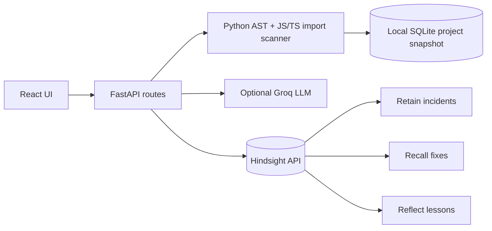

# CodeVision AI

**A repository-aware AI engineering companion with real Hindsight project memory.**

[Hindsight source](https://github.com/vectorize-io/hindsight) · [Documentation](https://hindsight.vectorize.io/) · [What is agent memory?](https://vectorize.io/what-is-agent-memory)

CodeVision helps developers orient themselves inside an unfamiliar repository, map static file dependencies, browse functions, investigate bugs using optional Groq, and explicitly retain developer-reported fixes in a separate [Hindsight](https://hindsight.vectorize.io/) memory bank per project. On a later session, Hindsight can recall those fixes and provide historical context.

> **Actual status of this downloadable snapshot:** Python backend passes its automated unit/API tests; **live Hindsight and Groq API connections and frontend npm build were not verified in the artifact-generation environment**. Complete the live checklist before public claims. Without API keys, code exploration works, but this is not a real memory demonstration.

## Quick start (Windows)

1. Install **Python 3.11–3.13** and **Node.js 20+** (npm included).
2. Unzip this project and double-click **`start_windows.bat`**. Or follow the manual commands below.
3. Navigate to **http://127.0.0.1:5173**. Click **Explore interactive demo**.
4. To enable real memory, open `.env`, set `HINDSIGHT_API_KEY` from the [Hindsight Cloud Connect page](https://ui.hindsight.vectorize.io), then **restart FastAPI**. `HINDSIGHT_BASE_URL` defaults to Cloud. You can alternatively run your own Hindsight server and set its URL.
5. To enable Groq explanations, set `GROQ_API_KEY`, then restart FastAPI. `GROQ_MODEL` defaults to `openai/gpt-oss-20b`—replace if your account does not have access.
6. Click **Agent memory → Retain sample fix**, then **AI investigator**. Compare the same question with memory **off** and **on**. Confirm Hindsight evidence appears and screenshots show the live mode.
7. For the official event, install and use **Band AI desktop** as required in the supplied problem guide: https://www.band.ai.

## Manual setup (Windows PowerShell)

Run from the project directory:

```powershell
py -3 -m venv .venv
.\.venv\Scripts\python.exe -m pip install -r backend\requirements.txt
Copy-Item .env.example .env
# Edit .env to add API credentials; never commit the file.
cd backend
..\.venv\Scripts\python.exe -m uvicorn app.main:app --host 127.0.0.1 --port 8000 --reload
```

Open a **second terminal** at the project root:

```powershell
cd frontend
npm install
npm run dev
```

Visit `http://127.0.0.1:5173` and Swagger at `http://127.0.0.1:8000/docs`.

## Manual setup (macOS / Linux)

```bash
cp .env.example .env
python3 -m venv .venv
.venv/bin/pip install -r backend/requirements.txt
(cd backend && ../.venv/bin/python -m uvicorn app.main:app --host 127.0.0.1 --port 8000 --reload)
# in another terminal: cd frontend && npm install && npm run dev
```

Alternatively `./start_mac_linux.sh` starts both processes.

## Demo walkthrough (three minutes)

1. **Problem**: Developers inherit repositories with unfamiliar modules and repeated errors.
2. **Load demo**: Sample repository `DemoAuth` has an intentionally vulnerable `src/auth.py` where `startswith()` incorrectly accepts token suffixes. This sample is **synthetic**, not a customer issue.
3. **Explore**: Overview → architecture graph → code explorer → auth function.
4. **Before memory**: Ask `Why does the authentication API accept demo-secret-evil as a valid token?` with Hindsight **off**. Take a screenshot of code-based reasoning.
5. **Retain**: Agent memory → **Retain sample fix**. Live Hindsight writes the synthetic incident, root cause, a safer proposed fix using `hmac.compare_digest`, and past failed approaches. **Do not say this succeeded unless the app returns success.**
6. **After memory**: Ask the **same question** with Hindsight **on**. Show the retrieved historical evidence. Optionally use **Reflect** to summarize lessons.
7. **Close**: Persistent memory keeps project history across sessions. A retrieved fix is historical evidence, not automatic proof of the current bug.

## Architecture



### Supported features (implemented)

| Capability | What it actually does |
|---|---|
| Public GitHub import | Fetches a **public** repo ZIP via GitHub API/codeload; limited to 12 MB compressed source |
| ZIP import | Reads supported text files with archive and path protections |
| File explorer | Shows source excerpts, Python AST symbols/imports and heuristic entry points |
| Architecture map | Builds a static import graph and renders a Mermaid flowchart |
| Execution overview | Shows **inferred** steps only; no actual execution tracing |
| Bug investigation | Groq reasoning with selected source excerpts **if keyed**, else deterministic static summary |
| Memory Retain | Writes explicit incident notes through the official Hindsight async SDK |
| Memory Recall | Fetches matching history from the same per-repository bank |
| Memory Reflect | Requests historical synthesis from Hindsight API |
| Persistent local data | SQLite stores analysis snapshots and successful retain event logs; **not** a fake fallback for Hindsight |
| Sample story | Built-in **synthetic** demo repository with token-prefix bug |

### Limitations (important)

- Python AST provides basic structural analysis. JS/TS dependency detection is regular-expression-based and not a full parser. Tree-sitter is an **extension idea**, not implemented in this version.
- This is **not** a complete interpreter, data-flow analyzer, security scanner, or autonomous bug fixer. It never executes imported source code.
- GitHub repositories must be public and under size/file limits; private repositories and large monorepos are out of scope.
- LLM explanations might be wrong. User-supplied source content and memory are untrusted; check tests and source of truth before applying any fix.
- Uploaded source is stored as a selected preview in local SQLite. Sending investigation questions to Groq transmits selected code excerpts; do not upload sensitive private code or secrets. The uploader filters some known secret files but **does not guarantee full secret redaction**.
- There is no login, tenancy isolation, encryption at rest, or rate limiting in this MVP. Run locally or behind authentication; do **not** expose the demo FastAPI directly to the open Internet.
- Memory banks are derived from stable repo identity. Uploaded identical ZIP byte files share a bank; changing the ZIP changes identity. Multiple users on the same publicly exposed backend would share local state—avoid public exposure.
- Hindsight API errors (including rate limits, payment/credit errors) are surfaced; there is no fake memory data. Reflect may use billable service credit.

## Tests

```bash
cd backend
python -m pip install -r requirements-dev.txt
python -m pytest -q
```

All unit tests use mocks for cloud services. **Passing tests do not prove live Hindsight connectivity.** Follow `docs/LIVE_TEST_CHECK.md` to validate end-to-end retain/recall with your actual credentials.

## API

| Method | Path | Function |
|---|---|---|
| `GET` | `/api/health` | configuration check (not real connectivity verification) |
| `POST` | `/api/demo` | load synthetic DemoAuth repo |
| `POST` | `/api/import/zip` | import ZIP form upload |
| `POST` | `/api/import/github` | import public repo URL |
| `GET` | `/api/projects` | list imported repositories |
| `GET` | `/api/projects/{id}` | full static analysis |
| `POST` | `/api/projects/{id}/ask` | investigate with optional Hindsight recall |
| `POST` | `/api/projects/{id}/resolutions` | retain a user-reported fix via Hindsight |
| `POST` | `/api/projects/{id}/demo/remember` | retain the synthetic auth example |
| `GET` | `/api/projects/{id}/resolutions` | local audit log of successful retains |
| `POST` | `/api/projects/{id}/reflect` | Hindsight Reflect synthesis |

## Project layout

```text
backend/app/{main,analysis,security,assistant,memory,store,config,demo_data}.py
backend/tests/              Automated tests
frontend/src/              React / TypeScript / Mermaid interface
content/                    Three article and three LinkedIn drafts
assets/                     Mermaid reference diagram
examples/demo-repo/         Intentionally flawed educational sample
scripts/                    Additional verification helpers
submission/                 Publishing and submission handoff
```

## Team workflow

Read **`docs/START_HERE_TEAM.md`**, **`docs/VIDEO_SCRIPT.md`**, **`docs/LIVE_TEST_CHECK.md`**, **`docs/JUDGE_QA.md`**, and **`docs/SUBMISSION_LINKS.md`**. The content guide requires an article and social post **per member** and one **team** YouTube video. All must be published publicly to count.

## License

See `LICENSE` (MIT). Sample bug is intentionally flawed and must not be used as authentication code in production.
